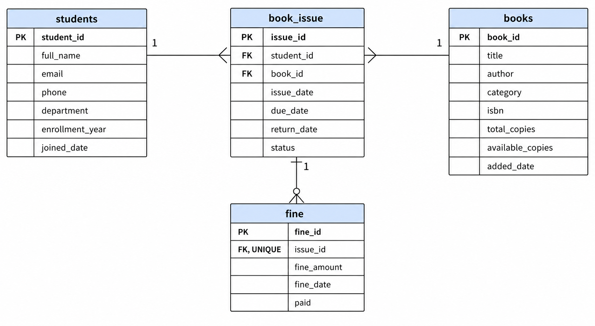
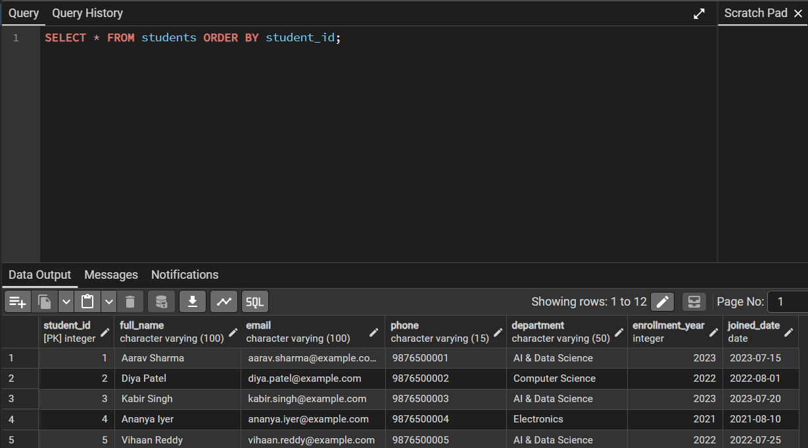
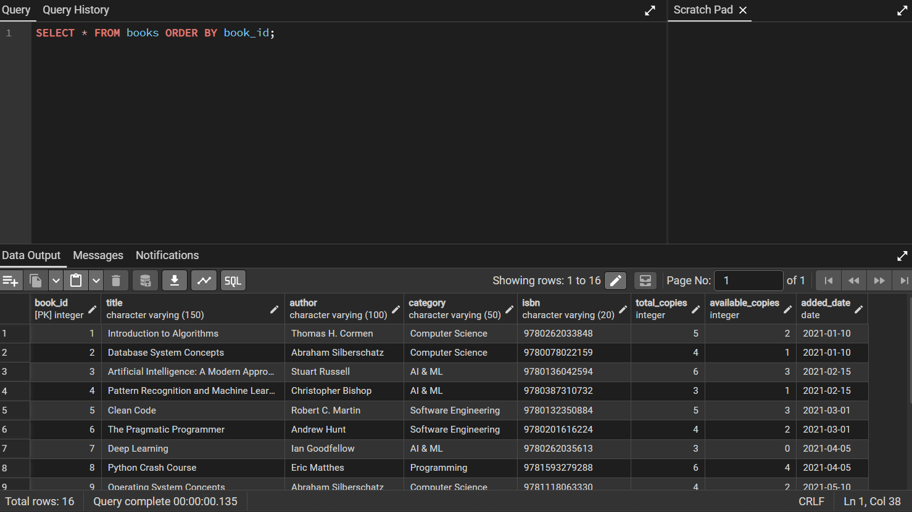
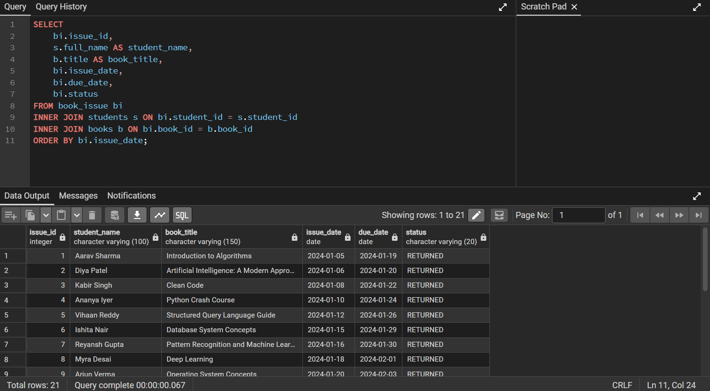
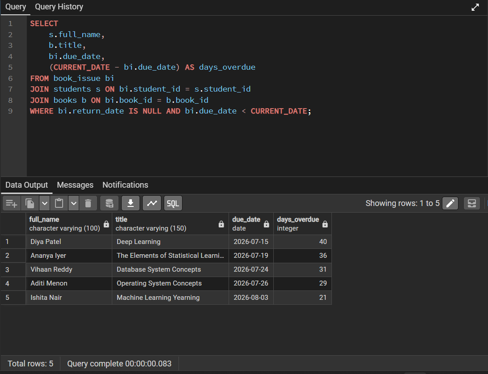
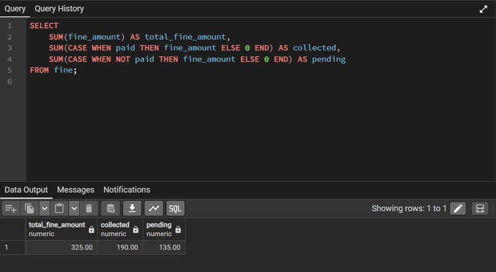

# Library Management System

A PostgreSQL-based relational database project for managing library operations: student records, a book catalog, book issuing/returns, and fine tracking. Built as a portfolio project to demonstrate relational database design and SQL querying.

## Project Overview

This project models a college library system where students borrow books, books get returned (on time or late), and fines are calculated for late returns. It focuses on correct relational design (primary keys, foreign keys, constraints) and a wide range of SQL query techniques.

## Features

- Student and book catalog management
- Book issuing with due dates
- Return tracking (built into the issue record, not a separate table)
- Automatic overdue detection based on due dates
- Fine tracking with paid/unpaid status
- 28 SQL queries covering joins, aggregates, subqueries, and CASE logic

## Technologies Used

- PostgreSQL
- pgAdmin (database management)
- SQL (DDL, DML, DQL)
- Git & GitHub (version control)

## Database Design

**Tables:** `students`, `books`, `book_issue`, `fine`

**Design decision:** "Return" is not a separate table. Return information (`return_date`, `status`) lives inside `book_issue`, since a return is just an update to an existing issue record, not a new entity.

### Relationships

- `students` (1) → (many) `book_issue`
- `books` (1) → (many) `book_issue`
- `book_issue` (1) → (0 or 1) `fine`

## ER Diagram



## Database Tables

**students**: student_id (PK), full_name, email (unique), phone (unique), department, enrollment_year, joined_date

**books**: book_id (PK), title, author, category, isbn (unique), total_copies, available_copies, added_date

**book_issue**: issue_id (PK), student_id (FK → students), book_id (FK → books), issue_date, due_date, return_date, status (ISSUED / RETURNED / OVERDUE)

**fine**: fine_id (PK), issue_id (FK → book_issue, unique), fine_amount, fine_date, paid

## SQL Concepts Demonstrated

- Primary keys, foreign keys, `CHECK`, `UNIQUE`, `DEFAULT` constraints
- `SELECT`, `WHERE`, `ORDER BY`
- `GROUP BY`, `HAVING`
- `INNER JOIN`, `LEFT JOIN` across multiple tables
- Aggregate functions (`COUNT`, `SUM`, `AVG`, `MIN`, `MAX`)
- `CASE` expressions for derived status labels
- Subqueries (`IN`, `NOT IN`)
- Date arithmetic for overdue and fine calculations

## Example Queries

Issue history with student and book names (multi-table JOIN):

```sql
SELECT bi.issue_id, s.full_name AS student_name, b.title AS book_title,
       bi.issue_date, bi.due_date, bi.status
FROM book_issue bi
INNER JOIN students s ON bi.student_id = s.student_id
INNER JOIN books b ON bi.book_id = b.book_id
ORDER BY bi.issue_date;
```

Calculating overdue days:

```sql
SELECT s.full_name, b.title, bi.due_date,
       (CURRENT_DATE - bi.due_date) AS days_overdue
FROM book_issue bi
JOIN students s ON bi.student_id = s.student_id
JOIN books b ON bi.book_id = b.book_id
WHERE bi.return_date IS NULL AND bi.due_date < CURRENT_DATE;
```

See [`sql/03_queries.sql`](sql/03_queries.sql) for all 28 queries.

## Screenshots

**All Students**


**All Books**


**Issue History**


**Overdue Books**


**Fine Analysis**


## Project Structure

```
library-management-system/
│
├── README.md
├── sql/
│   ├── 01_create_tables.sql
│   ├── 02_insert_data.sql
│   └── 03_queries.sql
├── diagrams/
│   └── ER_diagram.png
└── screenshots/
    ├── students_table.png
    ├── books_table.png
    ├── issue_history.png
    ├── overdue_books.png
    └── fine_analysis.png
```

## How to Run

1. Install PostgreSQL and pgAdmin
2. Create a database named `library_management`
3. Open the Query Tool and run `sql/01_create_tables.sql`
4. Run `sql/02_insert_data.sql` to load sample data
5. Run queries from `sql/03_queries.sql` to explore the data

## Future Improvements

- Add a `book_reservations` table for holds/waitlists
- Add stored procedures/triggers to auto-update `available_copies` and fine amounts
- Build a simple front-end (Flask/Django) on top of this schema
- Add role-based views for librarians vs students

## Author
Vipin T K
